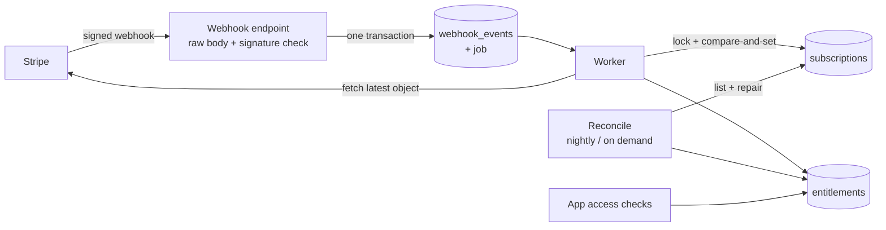
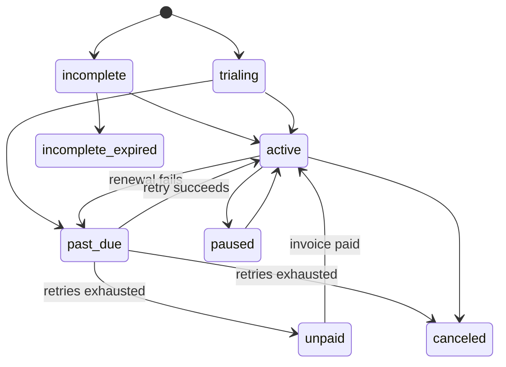

# stripe-billing-reliability-kit

**Stripe subscriptions that stay correct when webhooks arrive late, twice, out of order or not at all.** Two reference implementations (Next.js and Spring Boot) that share one database contract, a failure-injection harness that breaks delivery on purpose against real Stripe test mode, and a reconciliation job that repairs drift.


> All companies, people and data in this repository are fictional (the product is "PageMint").

## Demo


Recorded live against Stripe test mode: one event delivered three times gives one effect, a tampered payload is rejected with nothing processed, and a customer who pays while webhooks are down gets access back after a reconcile (exactly one repair). Re-record with `docs/demo/failure-demo.tape` (see its header).

## Results

Five failure scenarios, run against real Stripe test mode, per implementation. **Generated from `chaos/results/`; do not edit by hand.** Details, expected vs actual for every check, and run history: [docs/chaos.md](docs/chaos.md).

<!-- chaos:begin -->
| Scenario | `nextjs` | `spring-boot` |
|---|---|---|
| Duplicate delivery | PASS | PASS |
| Out-of-order delivery (updated before created) | PASS | PASS |
| Missed webhook (listener down while the customer pays) | PASS | PASS |
| Tampered payload | PASS | PASS |
| Renewal failure (test clock + failing card) | PASS* | PASS* (latest of 3 runs; 2 FAIL) |
<!-- chaos:end -->

`PASS*` = every check passed, but the account's Stripe retry setting ended the subscription as `canceled` instead of `unpaid`. Access is removed either way; the `unpaid` path itself was not exercised.

## Architecture



Subscription states and the access policy for each: [docs/state-machine.md](docs/state-machine.md).



## Quickstart

Requirements: Node 20+, Docker, Java 21 + Maven (for Spring), the Stripe CLI, and a Stripe **test-mode** key.

```bash
cp .env.example .env                     # fill in a TEST key; set POSTGRES_PORT if 5432 is taken
docker compose up -d postgres
npm ci && npm run --silent seed:stripe   # creates test-mode products/prices; copy the printed STRIPE_PRICE_* into .env
```

**Next.js**
```bash
set -a; . ./.env; set +a                 # the app reads its settings from the environment
cd nextjs && npm ci && npm run db:migrate
npm run dev                              # :3000 (DEMO_AUTH=1 enables the insecure demo login, local only)
npm run worker                           # second terminal
stripe listen --events checkout.session.completed,customer.subscription.created,customer.subscription.updated,customer.subscription.deleted,customer.subscription.trial_will_end,invoice.paid,invoice.payment_failed --forward-to localhost:3000/api/webhooks/stripe
```
**Spring Boot**: see [spring-boot/README.md](spring-boot/README.md).

**Tests**
```bash
set -a; . ./.env; set +a
npm test                                 # seed script + sample repro (the repro needs DATABASE_URL)
(cd nextjs && npm run typecheck && npm test)      # Docker: Testcontainers starts Postgres
(cd nextjs && npm run e2e)                        # LIVE: real browser + hosted Checkout, see nextjs/e2e/README.md
npm run flows:live                                # LIVE: the app's HTTP routes vs Stripe test mode (needs the dev server, see scripts/live/app-flows.mjs)
(cd spring-boot && mvn test)                      # Docker: Testcontainers
```

**Failure scenarios** (live, test mode)
```bash
chaos/targets/nextjs.sh up && chaos/run-all.sh && chaos/targets/nextjs.sh down
chaos/targets/spring-boot.sh up && CHAOS_TARGET=spring-boot chaos/run-all.sh && chaos/targets/spring-boot.sh down
```
See [chaos/README.md](chaos/README.md).

## Features

- **Verified webhooks:** raw-body signature verification before any parsing (Node runtime, not Edge); tampered, re-indented and unsigned payloads are rejected.
- **Idempotent and atomic:** `webhook_events` insert keyed on `event.id` and the job enqueue commit in one transaction; an enqueue failure returns 500 and leaves nothing behind.
- **Order-proof state:** each event triggers a fetch of the latest subscription, then a compare-and-set under per-subscription and per-user locks.
- **One source of truth for access:** `deriveEntitlement`; access checks read only `entitlements`; the checkout success redirect never grants access (it polls server state).
- **Reconciliation:** finds and repairs missed or drifted subscriptions, reports orphans without revoking, and has a circuit breaker for wrong-account/mode situations.
- **Admin:** webhook events with status/attempts/error, retry of failed events, run-reconcile (Next.js page, Spring API), gated by an allowlist.
- **Two implementations, one contract:** same tables (a test compares the schemas); the same failure scenarios are run against both (see Results and Limits). See [docs/api-contract.md](docs/api-contract.md).
- **Failure-injection harness and live e2e:** five scenarios with expected vs actual, generated into the docs, plus a Playwright test that pays on the real hosted Checkout page.
- **Portability notes:** [Supabase](docs/supabase.md) and [Firebase](docs/firebase.md) pattern guides.

## Design decisions

- **Fetch the latest object instead of trusting the event.** Ordering bugs disappear when state comes from the API; the compare-and-set on `event.created` is the backstop for concurrent workers, and the advisory locks make it race-free.
- **`past_due` grace is anchored on the failed period's start,** because Stripe has already advanced `current_period_end` at renewal. It is deterministic and does not depend on when a webhook was processed.
- **Reconcile never auto-revokes.** An orphan is reported for a human; repairs only go through the same sync path as webhooks.
- **Harness-signed replay for duplicate/out-of-order/tamper.** `stripe events resend` needs a registered endpoint; replaying real events signed with the listener's secret works with only `stripe listen`, and the scenarios check database effects, so they work on any implementation.
- **Every scenario's customer lives on a test clock,** so cleanup deletes its subscriptions and reconcile runs stay clean.
- **Spring uses plain SQL, not JPA,** so the locks and the compare-and-set are explicit; its queue is a transactional outbox with leases instead of pg-boss.

### Status: what is not done or not proven

Checked against the MVP scope in `SPEC.md` (M0-M6; M7 was deliberately skipped):

- **Not built:** Stripe API stubs in CI use in-memory fakes, not `stripe-mock`.
- **Proven live, but only by the opt-in e2e:** a purchase through the real hosted Checkout page with the 4242 test card grants access through the webhook worker, and the Customer Portal opens ([nextjs/e2e](nextjs/e2e/README.md), run locally; it needs your Stripe keys, so it is not part of CI).
- **Not exercised:** actions inside the Customer Portal (upgrade, downgrade, cancel), the nightly 03:00 reconcile actually firing, and the `unpaid` retry outcome (a Stripe Dashboard setting; the account ended subscriptions as `canceled`).
- **CI:** GitHub Actions has not run on this repository (an account billing block stops the jobs before they start), so the CI badge does not reflect the suites; they were run locally.
- **Renewal scenario reliability:** it waits on Stripe's test-clock processing and times out on some runs (counts in the Results table and [docs/chaos.md](docs/chaos.md), discussion in [chaos/README.md](chaos/README.md)). The recorded history has more failures on the Spring target, but a later full verification run, not recorded in that history, timed out on both targets, so treat the timeouts as Stripe-side latency until shown otherwise. "The same scenarios pass on both implementations" is therefore not fully demonstrated.
- **Deviations from SPEC:** reconcile scans everything because Stripe's subscription list has no `updated` filter; the Spring implementation has no checkout/portal (API, webhook, reconcile and admin only); duplicate delivery is replayed by the harness instead of `stripe events resend`.
- **Placeholders:** demo authentication (Next.js) is deliberately insecure and local-only; the Spring API expects tokens from your own identity provider. Per-seat Team quantity sync and proration (M7) are planned later.

## Sample deliverables

What a client receives, in [sample-deliverable/](sample-deliverable/) (fictional clients):

| Tier | File |
|---|---|
| Starter: fix one issue | [FIX_REPORT_duplicate-credits.md](sample-deliverable/FIX_REPORT_duplicate-credits.md) (with a runnable repro) |
| Standard | [WEBHOOK_HARDENING_REPORT.md](sample-deliverable/WEBHOOK_HARDENING_REPORT.md) |
| Advanced | [SUBSCRIPTIONS_IMPLEMENTATION_HANDOVER.md](sample-deliverable/SUBSCRIPTIONS_IMPLEMENTATION_HANDOVER.md) |

## Hire me

Need Stripe subscriptions and webhooks that hold up in production? [Hire me on Upwork](https://www.upwork.com/freelancers/~01c80d5fd70c92b97d).

## License

MIT. See [LICENSE](LICENSE).
