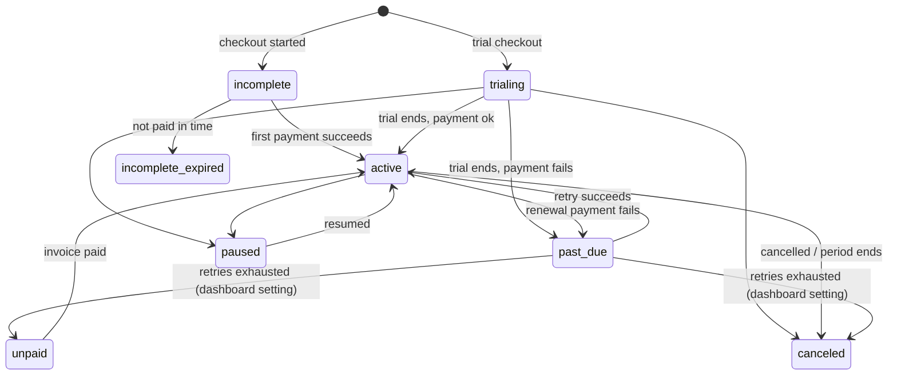

# Subscription state machine and access policy

Source of truth: `nextjs/src/lib/entitlements/derive.ts` (`deriveEntitlement`, `ACCESS_POLICY`, `RENEWAL_BUFFER_MS`, `PAST_DUE_GRACE_MS`). This page describes it; the tests in `nextjs/test/derive.test.ts` enforce it.

## Access policy

| Status | Access | `validUntil` |
|---|---|---|
| `incomplete`, `incomplete_expired` | none | – |
| `trialing` | plan | period end + `RENEWAL_BUFFER_MS` |
| `active` | plan | period end + `RENEWAL_BUFFER_MS` |
| `active` with `cancel_at_period_end` / `cancel_at` | plan | period end (no buffer) |
| `past_due` | plan (grace) | `current_period_start` + `PAST_DUE_GRACE_MS` |
| `unpaid`, `canceled`, `paused` | none | – |
| unknown status, missing dates, unknown price | none (fail closed) | – |

Design notes:
- `deriveEntitlement` is pure. It returns an absolute `validUntil`; `getEntitlement` compares it with the clock, so access ends on time even if no webhook arrives.
- Grace is anchored on the **start of the failed period** because Stripe has already advanced `current_period_end` at renewal. It is deterministic and does not depend on when we processed the event. Keep it shorter than Stripe's retry window.
- Whether retries end in `unpaid` or `canceled` is a Stripe Dashboard setting (Billing → Revenue recovery → subscription status after retries). Both remove access.
- A user can have several subscriptions; the entitlement is the best of all of them (`bestEntitlement`).
- `pause_collection` on an `active` subscription leaves status `active`; it is not treated specially.

## Ordering and concurrency
For every event the worker opens one transaction and: (1) takes a per-subscription advisory lock, (2) fetches the latest subscription from Stripe, (3) does a compare-and-set upsert that applies only if `updated_from_event_created` is not newer than the event, (4) takes a per-user advisory lock (always after the subscription lock, so no deadlock) and recomputes the user's entitlement from all their subscriptions. The user lock matters when two different subscriptions of one user sync at the same moment. A subscription can never move between users.
