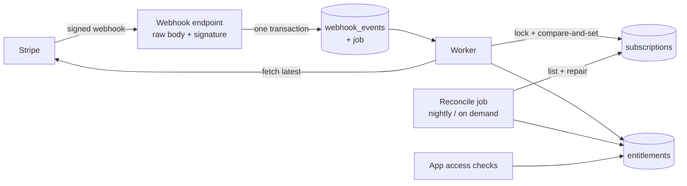

# Subscriptions implementation handover

> **Sample deliverable (Advanced).** Handover pack for a fictional product ("PageMint"). It documents the reference implementation in this repository: architecture, state machine, runbook and reconcile operations. Every scenario result below is generated from `chaos/results/`.

## 1. What you are receiving
- A Next.js implementation (`nextjs/`) and a Spring Boot implementation (`spring-boot/`) with the **same tables and webhook contract** ([`docs/api-contract.md`](../docs/api-contract.md)).
- A failure-injection harness (`chaos/`) that runs five scenarios against either implementation.
- A reconcile job, an admin page (Next.js) / admin API (Spring), and CI.

## 2. Architecture

Access checks read **only** `entitlements`. `deriveEntitlement` is the single source of truth and is used by webhooks, reconcile and the success page. See [`docs/state-machine.md`](../docs/state-machine.md) for the per-status policy (renewal buffer, `past_due` grace).

## 3. Runbook

**Configure.** Test-mode keys only until sign-off. Set `STRIPE_SECRET_KEY`, `STRIPE_WEBHOOK_SECRET`, `STRIPE_PRICE_*` (from `npm run --silent seed:stripe`), `DATABASE_URL`, and an admin allowlist (`ADMIN_EMAILS`). Register the endpoint in Stripe for the seven handled event types. Replace the demo authentication before any real use.

**Go live checklist.** New live-mode webhook endpoint and secret; live prices seeded; Customer Portal configured; Dashboard retry setting decided ("mark unpaid" vs "cancel"); reconcile run once in report-only mode (breaker) and reviewed; alert on failed events.

**Monitor.**
- Failed events: the admin events page (Next.js) or `GET /api/admin/events?status=failed` (Spring). A row can read `failed` while retries are still pending; it is dead only after the queue stops retrying.
- Reconcile: read the latest report; expect no repairs on a healthy system.

**When a customer says "I paid but have no access".**
1. Look up the customer's subscription in Stripe; check its status.
2. Look for its events in the admin page. Missing: the webhook never arrived. Failed: read the error.
3. Run a reconcile (admin button / CLI). It fetches the subscription and repairs the row and the entitlement.
4. Still wrong: check the price id is mapped (`unknown price` errors mean a `STRIPE_PRICE_*` variable is missing or wrong).

## 4. Reconcile operations
- Runs nightly (03:00 UTC) and on demand; one run at a time (advisory lock).
- Detects `missing_in_db`, `field_mismatch`, `entitlement_stale`, `orphan`. Repairs go through the same sync as webhooks (fresh fetch under a lock). Orphans are **reported, never auto-revoked**.
- A **circuit breaker** stops repairs and reports only when most subscriptions drift (wrong account or mode).
- Stripe hides test-clock subscriptions from the global list, so reconcile also lists per known customer.
- Report shape and locations: [`docs/api-contract.md`](../docs/api-contract.md).

## 5. Verified behaviour
Results of the five failure scenarios against Stripe test mode, per implementation (generated):

<!-- generated:chaos -->
| Scenario | `nextjs` | `spring-boot` |
|---|---|---|
| Duplicate delivery | PASS | PASS |
| Out-of-order delivery (updated before created) | PASS | PASS |
| Missed webhook (listener down while the customer pays) | PASS | PASS |
| Tampered payload | PASS | PASS |
| Renewal failure (test clock + failing card) | PASS* | FAIL |
<!-- /generated -->

`PASS*` means all checks passed but the account's retry setting ended the subscription as `canceled` instead of `unpaid`; access is removed either way, but the `unpaid` path itself was not exercised.

## 6. Known limits (from the reviews)
- The hosted Checkout purchase and Customer Portal were not exercised against real Stripe in this repository's runs; subscriptions in the scenarios are created through the API.
- The renewal scenario waits on Stripe's test-clock processing and has timed out on some runs of the Spring target; see [`chaos/README.md`](../chaos/README.md).
- Demo authentication (Next.js) and the JWT-only API (Spring) are placeholders for your identity provider.
- Team per-seat quantity sync and proration preview are out of scope (planned later).
