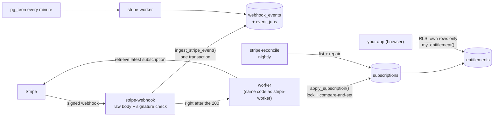

# Supabase implementation (Edge Functions + Postgres)

The same billing guarantees as the Next.js and Spring Boot implementations, for apps built on Supabase: a Stripe webhook Edge Function, a worker, a reconcile job, and one SQL migration that holds the tables, row level security and every write path.



## What's in it

| Path | What it does |
|---|---|
| `migrations/20261025000000_billing.sql` | The shared tables ([api-contract](../docs/api-contract.md), checked column for column against the Next.js schema), an outbox job table, RLS, and SQL functions: `ingest_stripe_event`, `claim_event_jobs`, `apply_subscription`, `derive_entitlement`, `my_entitlement`, `requeue_event`, leases |
| `functions/stripe-webhook` | Verifies the signature over the raw body (`constructEventAsync` + SubtleCrypto), inserts the event and its job atomically, returns 200, then processes the queue in the background |
| `functions/stripe-worker` | Retries failed or leftover events (pg_cron calls it every minute); service-role only |
| `functions/stripe-reconcile` | Lists subscriptions from Stripe, repairs drift through the same SQL path, reports orphans without revoking, stores the report in `reconcile_runs` |
| `schedule.sql` | One-off: pg_cron jobs for the worker and nightly reconcile, credentials read from Vault |

### The rules, and where they live

| Rule | Here |
|---|---|
| Verify the raw body before parsing | `functions/_shared/webhook.ts` (`req.text()`, then `constructEventAsync`) |
| Idempotent on `event.id`, insert + enqueue atomic | `ingest_stripe_event()`: one function, one transaction |
| Don't trust event order | worker fetches the latest subscription; `apply_subscription()` takes a per-subscription advisory lock and compares the event clock |
| One function decides access | `derive_entitlement()` in SQL; a test proves it returns the same result as the Next.js `deriveEntitlement` for all 648 combinations |
| Users can only read their own billing state | RLS on every table; `my_entitlement()` for the browser (expired reads as free) |
| Never grant from the success redirect | the success page should poll `my_entitlement()` |
| Repair missed events | `stripe-reconcile`, nightly via pg_cron |
| Fail loudly | unknown price ids and unmapped customers raise errors and stay visible in `webhook_events.error`; jobs retry with backoff (5 s doubling, 1 h cap) |

**One difference from the Next.js version:** PostgREST calls can't hold a database lock while the function calls Stripe, so the worker fetches from Stripe first and then applies in one transaction. The event clock (`event.created`) stops an older event from overwriting newer state; for reconcile, the snapshot is skipped if a webhook updated the row after the fetch started (`p_fetched_at`, tested).

## Run it locally

Needs Docker, the [Supabase CLI](https://supabase.com/docs/guides/cli) and the Stripe CLI, plus the repository's `.env` (test key and prices from `npm run seed:stripe`).

```bash
supabase start                                   # from the repository root
supabase db reset                                # applies supabase/migrations
cp supabase/functions/.env.example supabase/functions/.env   # fill in TEST key, prices, and the secret printed by `stripe listen`
supabase functions serve --env-file supabase/functions/.env
stripe listen --forward-to http://127.0.0.1:54321/functions/v1/stripe-webhook
```

Run the five live failure scenarios against it, exactly as for the other implementations:

```bash
chaos/targets/supabase.sh up && CHAOS_TARGET=supabase chaos/run-all.sh && chaos/targets/supabase.sh down
```

## Tests

```bash
cd supabase/functions
deno task check                                   # type-checks the three functions
TEST_DATABASE_URL=postgres://postgres@127.0.0.1:5432/postgres deno task test
```

21 tests, run in CI against Postgres 16: real Stripe signature verification (tampered, re-indented, wrong-secret and unsigned payloads rejected), duplicate delivery, out-of-order events, missed webhook repaired by reconcile, renewal failure grace period, unknown price, unmapped customer, concurrent queue claims, RLS isolation between users, SQL-vs-TypeScript access-policy parity, and schema parity with the Next.js tables. The tests use a fake Stripe and stub Supabase's roles and `auth` schema (`tests/supabase-stub.sql`) so they run on plain Postgres.

## Deploy

```bash
supabase link --project-ref <ref>
supabase db push
supabase secrets set --env-file supabase/functions/.env    # TEST key first; live only after sign-off
supabase functions deploy stripe-webhook stripe-worker stripe-reconcile --no-verify-jwt
```

Then run `schedule.sql` once in the SQL editor, and register `https://<ref>.supabase.co/functions/v1/stripe-webhook` in Stripe with the subscription events (`npm run health:stripe` checks the endpoint afterwards).

## Status

- **Tested here:** everything listed under Tests, on every push.
- **Not yet run:** the live chaos scenarios against `supabase functions serve`, and a deployed project. `chaos/targets/supabase.sh` is ready for that run; results will appear in the main README table as a `supabase` column once recorded.
- **Not built:** Checkout/Customer Portal session endpoints (use the Next.js routes as the pattern), per-seat Team quantity sync.
